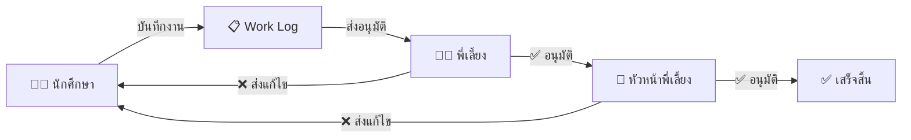
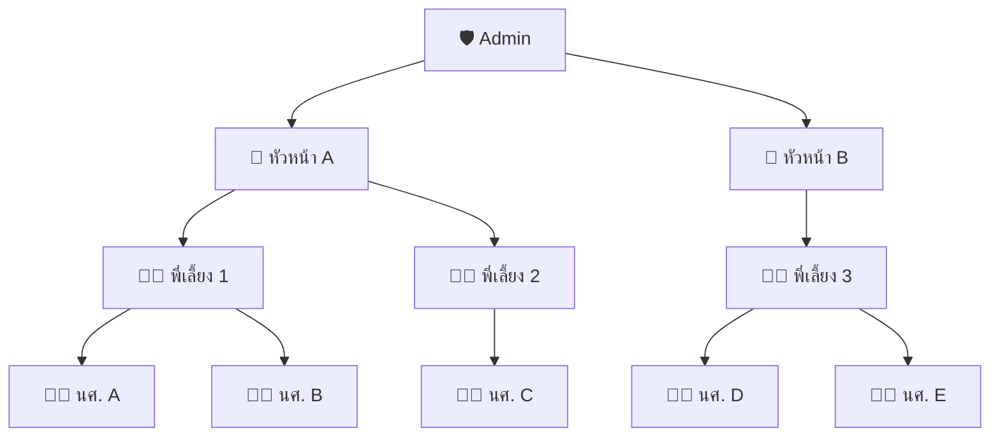
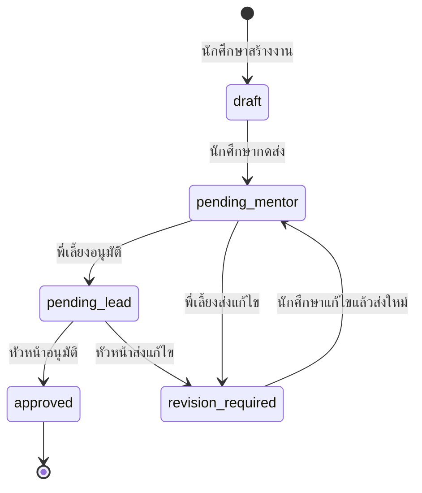
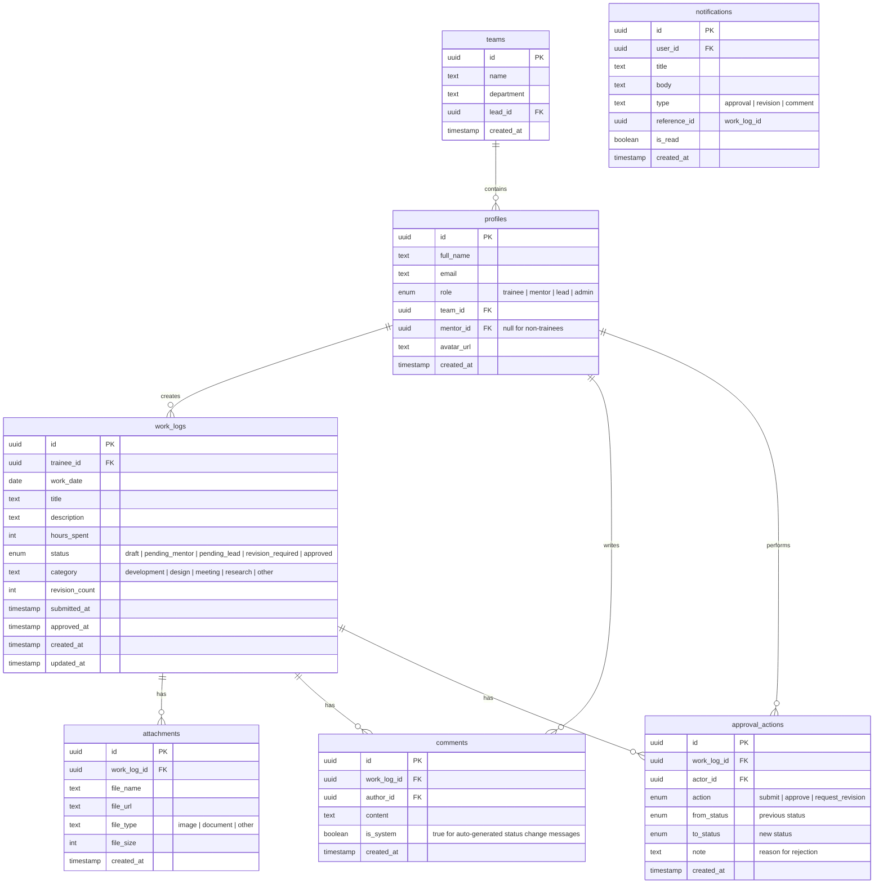

# TrainTrack — ระบบบันทึกงานฝึกงาน (Hybrid App)

## Design Document

> **Tech Stack:** Next.js 14 + Capacitor · Supabase (Auth + PostgreSQL + Edge Functions + Storage + Realtime)
> **Platforms:** iOS · Android · Web (PWA)

---

## 1. ภาพรวมระบบ

แอปสำหรับ **นักศึกษาฝึกงาน** บันทึกงานประจำวัน พร้อมระบบอนุมัติแบบลำดับขั้น (Sequential Approval) ผ่านพี่เลี้ยงและหัวหน้าพี่เลี้ยง



---

## 2. บทบาทผู้ใช้ (Roles & Permissions)

| บทบาท | สิทธิ์หลัก |
|--------|-----------|
| **นักศึกษาฝึกงาน** `trainee` | สร้าง/แก้ไขงานของตัวเอง · แนบไฟล์ · ดู Dashboard ตัวเอง · ดูความคิดเห็นจากพี่เลี้ยง |
| **พี่เลี้ยง** `mentor` | ดูงานของนักศึกษาในสังกัด · อนุมัติ/ส่งแก้ไข · แสดงความคิดเห็น · ดูสรุปนักศึกษาทั้งหมด |
| **หัวหน้าพี่เลี้ยง** `lead` | ดูงานที่พี่เลี้ยงอนุมัติแล้ว · อนุมัติขั้นสุดท้าย/ส่งแก้ไข · ดู Dashboard ภาพรวมทีม |
| **Admin** `admin` | จัดการผู้ใช้ · จัดการทีม/แผนก · ดู Dashboard ทั้งระบบ · Export รายงาน |

### ความสัมพันธ์ระหว่างบทบาท



---

## 3. Approval Workflow (รายละเอียด)

### 3.1 สถานะของงาน (Status Flow)



| สถานะ | ความหมาย | ใครเห็น | ใครทำอะไรได้ |
|--------|---------|---------|-------------|
| `draft` | แบบร่าง ยังไม่ส่ง | นักศึกษาเท่านั้น | นักศึกษา: แก้ไข, ลบ, ส่ง |
| `pending_mentor` | รอพี่เลี้ยงตรวจ | นักศึกษา + พี่เลี้ยง | พี่เลี้ยง: อนุมัติ / ส่งแก้ไข + comment |
| `pending_lead` | รอหัวหน้าอนุมัติ | ทุกคน | หัวหน้า: อนุมัติ / ส่งแก้ไข + comment |
| `revision_required` | ต้องแก้ไข | นักศึกษา + พี่เลี้ยง | นักศึกษา: แก้ไขแล้วส่งใหม่ |
| `approved` | อนุมัติแล้ว | ทุกคน | อ่านอย่างเดียว |

### 3.2 กฎของ Workflow

1. **นักศึกษาสามารถบันทึกเป็น draft ก่อนได้** — ไม่ต้องส่งทันที สามารถกลับมาแก้ไขได้
2. **เมื่อถูกส่งแก้ไข** — นักศึกษาจะเห็น comment ที่บอกสิ่งที่ต้องแก้ สามารถแก้ไขเนื้อหาแล้วกด "ส่งใหม่" (กลับไปที่พี่เลี้ยงทุกครั้ง แม้หัวหน้าเป็นคนส่งแก้ไข)
3. **ประวัติการอนุมัติ** — ทุก action (อนุมัติ/ส่งแก้ไข) จะถูกบันทึกเป็น audit trail ดูย้อนหลังได้
4. **Notification** — ทุกการเปลี่ยนสถานะจะส่ง Push Notification ไปยังคนที่เกี่ยวข้อง

---

## 4. Data Model (Supabase PostgreSQL)

### 4.1 ER Diagram



---

## 5. หน้าจอแอป (Screens)

### 5.1 นักศึกษาฝึกงาน

```
📱 Tab Bar: [หน้าหลัก] [บันทึกงาน] [งานของฉัน] [โปรไฟล์]
```

| หน้าจอ | รายละเอียด |
|--------|-----------|
| **🏠 หน้าหลัก (Dashboard)** | สรุปสถิติ: งานทั้งหมด · รออนุมัติ · อนุมัติแล้ว · ต้องแก้ไข · ชั่วโมงรวม สัปดาห์นี้ · กราฟความก้าวหน้ารายสัปดาห์ |
| **➕ บันทึกงานใหม่** | ฟอร์ม: วันที่ · หัวข้องาน · รายละเอียด · หมวดหมู่ · ชั่วโมงที่ใช้ · แนบรูป/ไฟล์ (สูงสุด 5 ไฟล์) · ปุ่ม [บันทึกแบบร่าง] / [ส่งอนุมัติ] |
| **📋 งานของฉัน** | รายการงานทั้งหมด filter ตามสถานะ · แต่ละรายการแสดง: วันที่ · หัวข้อ · สถานะ (badge สี) · จำนวน comment |
| **📄 รายละเอียดงาน** | เนื้อหาเต็ม · ไฟล์แนบ · timeline ของ approval · comments · ปุ่ม [แก้ไข] (ถ้าสถานะเป็น draft/revision_required) |
| **🔔 การแจ้งเตือน** | รายการ notification ทั้งหมด กดแล้วไปหน้างานที่เกี่ยวข้อง |
| **👤 โปรไฟล์** | ข้อมูลส่วนตัว · ชื่อพี่เลี้ยง · ทีม · ตั้งค่า notification |

### 5.2 พี่เลี้ยง (Mentor)

```
📱 Tab Bar: [หน้าหลัก] [รอตรวจ] [นักศึกษา] [โปรไฟล์]
```

| หน้าจอ | รายละเอียด |
|--------|-----------|
| **🏠 หน้าหลัก** | จำนวนงานรอตรวจ (badge แดง) · สรุปนักศึกษาแต่ละคน (ส่งงานแล้ว/ยังไม่ส่ง วันนี้) |
| **📥 รอตรวจ** | รายการงานสถานะ `pending_mentor` จากนักศึกษาทุกคนในสังกัด · sort ตามวันที่ส่ง |
| **📄 ตรวจงาน** | เนื้อหาเต็ม + ไฟล์แนบ · ปุ่ม [✅ อนุมัติ] / [❌ ส่งแก้ไข (ต้องพิมพ์เหตุผล)] · ช่อง comment |
| **👥 นักศึกษา** | รายชื่อนักศึกษาในสังกัด · กดแต่ละคนเห็นประวัติงานทั้งหมด + สถิติ |

### 5.3 หัวหน้าพี่เลี้ยง (Lead)

```
📱 Tab Bar: [หน้าหลัก] [รออนุมัติ] [ภาพรวมทีม] [โปรไฟล์]
```

| หน้าจอ | รายละเอียด |
|--------|-----------|
| **🏠 หน้าหลัก** | จำนวนงานรออนุมัติ · สรุปภาพรวมทีม (จำนวนนักศึกษา · งานที่ส่งสัปดาห์นี้ · อัตราการอนุมัติ) |
| **📥 รออนุมัติ** | รายการงานสถานะ `pending_lead` · แสดงชื่อนักศึกษา + พี่เลี้ยงที่อนุมัติแล้ว |
| **📄 อนุมัติงาน** | เนื้อหาเต็ม · เห็น comment จากพี่เลี้ยง · ปุ่ม [✅ อนุมัติ] / [❌ ส่งแก้ไข] |
| **📊 ภาพรวมทีม** | Dashboard: กราฟจำนวนงานรายสัปดาห์ · อันดับนักศึกษา (ชั่วโมงรวม) · สถิติตามหมวดหมู่ |

### 5.4 Admin

```
📱 Tab Bar: [Dashboard] [จัดการผู้ใช้] [จัดการทีม] [ตั้งค่า]
```

| หน้าจอ | รายละเอียด |
|--------|-----------|
| **📊 Dashboard** | สถิติทั้งระบบ: ผู้ใช้ทั้งหมด · งานทั้งหมด · อัตราอนุมัติ · กราฟแนวโน้ม |
| **👥 จัดการผู้ใช้** | CRUD ผู้ใช้ · กำหนด role · จับคู่นักศึกษา-พี่เลี้ยง · Import จาก CSV |
| **🏢 จัดการทีม** | สร้าง/แก้ไขทีม · กำหนดหัวหน้า · ย้ายสมาชิก |
| **📤 Export** | ส่งออกรายงานเป็น PDF/Excel ตามช่วงเวลา |

---

## 6. Push Notification Triggers

| เหตุการณ์ | ใครได้รับ | ข้อความตัวอย่าง |
|----------|----------|---------------|
| นักศึกษาส่งงาน | พี่เลี้ยง | "🆕 นศ.สมชาย ส่งงานใหม่: พัฒนาหน้า Login" |
| พี่เลี้ยงอนุมัติ | หัวหน้า + นักศึกษา | "✅ งาน 'พัฒนาหน้า Login' ผ่านการตรวจจากพี่เลี้ยงแล้ว" |
| พี่เลี้ยงส่งแก้ไข | นักศึกษา | "📝 งาน 'พัฒนาหน้า Login' ต้องแก้ไข — กรุณาตรวจสอบ" |
| หัวหน้าอนุมัติ | นักศึกษา + พี่เลี้ยง | "🎉 งาน 'พัฒนาหน้า Login' ได้รับอนุมัติเรียบร้อย!" |
| หัวหน้าส่งแก้ไข | นักศึกษา + พี่เลี้ยง | "📝 งาน 'พัฒนาหน้า Login' ถูกส่งกลับแก้ไขโดยหัวหน้า" |
| มี comment ใหม่ | เจ้าของงาน + ผู้เกี่ยวข้อง | "💬 พี่เลี้ยงสมศักดิ์ แสดงความเห็นในงานของคุณ" |
| นักศึกษาไม่ส่งงาน 2 วัน | พี่เลี้ยง | "⚠️ นศ.สมชาย ไม่ได้ส่งงานมา 2 วันแล้ว" |

---

## 7. โครงสร้างโปรเจกต์

```
traintrack/
├── src/
│   ├── app/                    # Next.js App Router
│   │   ├── (auth)/             # หน้า login / register
│   │   │   ├── login/page.tsx
│   │   │   └── register/page.tsx
│   │   ├── (main)/             # หน้าหลัก (ต้อง login)
│   │   │   ├── layout.tsx      # Tab Bar layout
│   │   │   ├── dashboard/page.tsx
│   │   │   ├── work-logs/
│   │   │   │   ├── page.tsx           # รายการงาน
│   │   │   │   ├── new/page.tsx       # สร้างงานใหม่
│   │   │   │   └── [id]/page.tsx      # รายละเอียด/แก้ไข
│   │   │   ├── reviews/               # สำหรับ mentor/lead
│   │   │   │   ├── page.tsx           # รายการรอตรวจ
│   │   │   │   └── [id]/page.tsx      # ตรวจงาน
│   │   │   ├── team/                  # สำหรับ mentor/lead
│   │   │   │   └── page.tsx
│   │   │   ├── admin/                 # สำหรับ admin
│   │   │   │   ├── users/page.tsx
│   │   │   │   ├── teams/page.tsx
│   │   │   │   └── reports/page.tsx
│   │   │   ├── notifications/page.tsx
│   │   │   └── profile/page.tsx
│   │   └── layout.tsx
│   ├── components/
│   │   ├── ui/                 # ปุ่ม, input, card, badge, modal
│   │   ├── work-log/           # WorkLogCard, WorkLogForm, StatusBadge
│   │   ├── review/             # ReviewActions, ApprovalTimeline
│   │   ├── dashboard/          # StatCard, WeeklyChart, CategoryPie
│   │   └── layout/             # TabBar, Header, BottomSheet
│   ├── services/
│   │   ├── supabase.ts         # Supabase client
│   │   ├── auth.service.ts     # login, logout, session
│   │   ├── worklog.service.ts  # CRUD work logs
│   │   ├── review.service.ts   # approve, reject
│   │   ├── upload.service.ts   # file upload to Storage
│   │   ├── notification.service.ts  # push notification
│   │   └── native/             # Capacitor plugin wrappers
│   │       ├── camera.ts
│   │       ├── filesystem.ts
│   │       └── push.ts
│   ├── hooks/
│   │   ├── useAuth.ts
│   │   ├── useWorkLogs.ts
│   │   ├── useReviews.ts
│   │   ├── useRealtime.ts      # Supabase Realtime subscriptions
│   │   └── useNotifications.ts
│   ├── store/                  # Zustand state management
│   │   ├── authStore.ts
│   │   └── notificationStore.ts
│   ├── lib/
│   │   ├── constants.ts
│   │   ├── types.ts            # TypeScript interfaces
│   │   └── utils.ts
│   └── theme/
│       ├── globals.css
│       └── tokens.ts           # colors, spacing, typography
├── supabase/
│   ├── migrations/             # SQL migrations
│   │   ├── 001_create_tables.sql
│   │   ├── 002_rls_policies.sql
│   │   └── 003_functions.sql
│   └── functions/              # Edge Functions
│       ├── send-notification/
│       └── generate-report/
├── public/
│   ├── icons/
│   └── splash/
├── capacitor.config.ts
├── next.config.js
├── tailwind.config.ts
├── package.json
└── tsconfig.json
```

---

## 8. Security (Row Level Security)

> [!IMPORTANT]
> Supabase RLS ทำให้แต่ละ role เห็นเฉพาะข้อมูลที่เกี่ยวข้อง โดยไม่ต้องเขียน logic ฝั่ง client

### หลักการ RLS สำคัญ:

| Table | trainee | mentor | lead | admin |
|-------|---------|--------|------|-------|
| `work_logs` | CRUD ของตัวเอง | READ ของนักศึกษาในสังกัด | READ ที่สถานะ ≥ pending_lead | READ/WRITE ทั้งหมด |
| `comments` | READ/CREATE ในงานตัวเอง | READ/CREATE ในงานนักศึกษาสังกัด | READ/CREATE ในงานทีม | ทั้งหมด |
| `approval_actions` | READ ในงานตัวเอง | CREATE (approve/reject) | CREATE (approve/reject) | ทั้งหมด |
| `profiles` | READ ของตัวเอง + พี่เลี้ยง | READ ของนักศึกษาสังกัด | READ ของทีม | CRUD ทั้งหมด |

---

## 9. Key UX Decisions

### 9.1 ทำไมส่งกลับนักศึกษาทุกครั้ง (ไม่ส่งกลับพี่เลี้ยง)

เมื่อหัวหน้าส่งแก้ไข → งานกลับไปที่ **นักศึกษาโดยตรง** (ไม่ใช่พี่เลี้ยง) เพราะ:
- นักศึกษาเป็นเจ้าของเนื้อหา ต้องแก้ไขเอง
- พี่เลี้ยงจะได้รับ notification ด้วย เพื่อติดตามและช่วยเหลือ
- เมื่อนักศึกษาส่งใหม่ จะเริ่มผ่านพี่เลี้ยงก่อนเสมอ (ไม่ข้ามขั้นตอน)

### 9.2 Draft Mode

- นักศึกษาสามารถบันทึก draft ไว้ก่อน → กลับมาเขียนต่อ/แก้ไข → ค่อยส่ง
- Draft **ไม่แสดง**ให้พี่เลี้ยงเห็น จนกว่าจะกดส่ง
- ป้องกันการส่งงานที่ยังไม่สมบูรณ์

### 9.3 สี Status Badge

| สถานะ | สี | ไอคอน |
|--------|-----|------|
| `draft` | ⚪ เทา | ✏️ |
| `pending_mentor` | 🟡 เหลือง | ⏳ |
| `pending_lead` | 🔵 น้ำเงิน | ⏳ |
| `revision_required` | 🟠 ส้ม | 🔄 |
| `approved` | 🟢 เขียว | ✅ |

---

## 10. Approaches ที่พิจารณา

### แนวทางที่ 1: Supabase Realtime + Edge Functions ✅ (เลือก)
- **ข้อดี:** Realtime subscriptions ทำให้หน้าจอ update ทันทีเมื่อมีการอนุมัติ · Edge Functions จัดการ push notification · RLS จัดการ security ที่ระดับ database
- **ข้อเสีย:** ต้องเรียนรู้ Supabase RLS policies

### แนวทางที่ 2: Supabase + Custom API (Next.js API Routes)
- **ข้อดี:** ควบคุม business logic ง่ายกว่า
- **ข้อเสีย:** ต้องเขียน API เอง ทำให้ช้ากว่า · ไม่ได้ประโยชน์จาก Realtime เต็มที่

### แนวทางที่ 3: REST API แยก (Express) + Supabase เป็นแค่ DB
- **ข้อดี:** แยก backend ชัดเจน
- **ข้อเสีย:** ซับซ้อนเกินไปสำหรับ scope นี้ · deploy/maintain 2 services

**เลือกแนวทางที่ 1** เพราะใช้ Supabase ได้เต็มประสิทธิภาพ ลดโค้ดที่ต้องเขียนเอง และได้ Realtime ที่ทำให้ UX ดีมาก

---

## 11. สิ่งที่เหลือให้ Builder ตัดสินใจ

- UI Component Library: Shadcn/ui (แนะนำ) หรือ Ionic Components
- State Management: Zustand (แนะนำ — เบา) หรือ Jotai
- Chart Library: Recharts (แนะนำ) หรือ Chart.js
- Icon: Lucide React (แนะนำ)
- รูปแบบ date picker สำหรับเลือกวันที่ทำงาน
